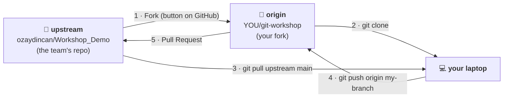
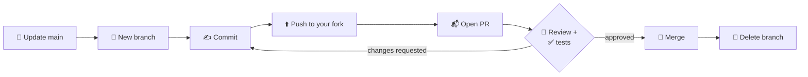

# 03 · GitHub workflow: forks, protected `main`, pull requests

## The big picture



There are three copies of the project:

- **upstream:** the team's official repo. You can read it but can't push to it.
- **origin:** **your fork**, your personal copy on GitHub. You can push anything here.
- **your laptop:** where you actually work.

Your changes travel **laptop → your fork → pull request → upstream**.

> 💡 In some team repos where you're a member, you'll skip the fork and push
> branches straight to the team repo. Everything else (branches, pull requests,
> reviews) is exactly the same.

## Forking

On the upstream repo page click **Fork** (top right) → **Create fork**. You now
have `github.com/YOU/git-workshop`.

Clone **your fork** and tell git where upstream is:

```bash
git clone git@github.com:YOU/git-workshop.git
cd git-workshop
git remote add upstream git@github.com:ozaydincan/Workshop_Demo.git
git remote -v
```

```
origin    git@github.com:YOU/git-workshop.git (fetch)
origin    git@github.com:YOU/git-workshop.git (push)
upstream  git@github.com:ozaydincan/Workshop_Demo.git (fetch)
upstream  git@github.com:ozaydincan/Workshop_Demo.git (push)
```

## Protecting `main`

**Branch protection** is how GitHub *enforces* the rule "nobody pushes directly
to `main`". The team repo already has it. In Exercise 2 you'll turn it on for
your own fork.

**Settings → Rules → Rulesets → New ruleset → New branch ruleset**

| Field | Value |
|-------|-------|
| Ruleset name | `protect-main` |
| Enforcement status | **Active** |
| Target branches | **Add target → Include default branch** |
| ☑ Restrict deletions | nobody can delete `main` |
| ☑ Require a pull request before merging | no direct pushes to `main` |
| ☑ Block force pushes | nobody can rewrite `main`'s history |

On the team repo, two more rules are on: **1 approval required** (someone else
must review) and **status checks must pass** (the automatic tests must be green).

> You might also see the older **Settings → Branches → Add branch protection rule**.
> It does the same job.

## Pull requests

A **pull request (PR)** says: *"Here is my branch. Please review it and merge
it into `main`."* One PR = one branch = one feature.

### The lifecycle



### 1. Update `main`, then create a branch

```bash
git switch main
git pull upstream main                    # get the team's latest version
git switch -c yourname/fix-lap-format     # a new branch for ONE thing
```

### 2. Work and commit

```bash
# ...edit files...
git status
git add ecotrack/laps.py
git commit -m "Fix zero padding in format_lap_time"
```

### 3. Push the branch to your fork

```bash
git push -u origin yourname/fix-lap-format
```

The `-u` means that next time, plain `git push` is enough.

### 4. Open the PR

After pushing, your fork's page on GitHub shows a yellow banner:
**"Compare & pull request"**. Click it and check the line at the top:

```
base repository: ozaydincan/Workshop_Demo   base: main   ←   head repository: YOU/git-workshop   compare: yourname/fix-lap-format
```

Write a short title and description (`Closes #3` if it fixes issue 3) → **Create pull request**.

### 5. Tests and review

- At the bottom of the PR, **checks** run automatically. ✅ green is good. ❌ red
  means click **Details** to see what went wrong.
- A reviewer opens the **Files changed** tab and can comment on any line,
  suggest a change, **Approve**, or **Request changes**.

### 6. Fix what the reviewer asked

Just commit and push again **on the same branch**. The PR updates by itself:

```bash
git add ecotrack/laps.py
git commit -m "Handle zero seconds"
git push
```

### 7. If `main` changed in the meantime

If GitHub says *"This branch is out-of-date"* or *"This branch has conflicts"*,
bring the latest `main` into your branch in one of two ways:

```bash
# Merge (see Exercise 5)
git pull upstream main
git push

# or rebase (see Exercise 7 and the rebase guide)
git fetch upstream
git rebase upstream/main
git push --force-with-lease
```

### 8. Merge and clean up

When it's approved and green, a maintainer clicks **Squash and merge**, and the
branch is deleted on GitHub. On your laptop:

```bash
git switch main
git pull upstream main                   # your main now contains your merged work
git branch -D yourname/fix-lap-format    # delete the finished branch
```

> Why capital `-D`? GitHub *squashed* your commits into a new one, so git doesn't
> recognise your branch as merged and the lowercase `-d` would refuse.

## Issues

**Issues** are GitHub's to-do list. Each task in [05-tasks.md](05-tasks.md) is
an issue. Comment *"I'll take this"* so two people don't do the same one, and write
`Closes #12` in your PR so the issue closes when the PR is merged.

Next: **[04 · Exercises →](04-exercises.md)**
